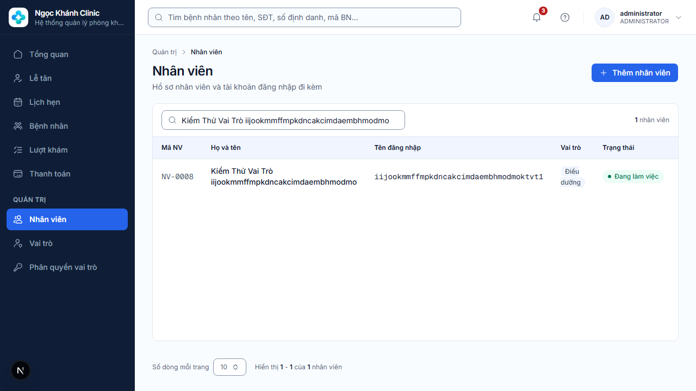

# Kiểm thử E2E đổi vai trò tài khoản

Thực hiện đêm 16–17/10/2026 (Asia/Saigon), trên nhánh
`feature/accesscontrol/change-user-role` của cả frontend và backend, gồm các thay
đổi chưa commit. Module sở hữu: `accesscontrol`; chức năng UC-010.

Kết quả cuối: **5/5 E2E đạt**, **798/798 kiểm thử frontend đạt**,
**38/38 kiểm thử backend liên quan đạt**, không có kiểm thử bị bỏ qua trong các
lần chạy cuối. Lint, TypeScript, terminology guard và production build frontend đạt.

## Môi trường và hợp đồng

- Frontend Next.js 16.3.5 tại `http://localhost:3000`.
- Backend Spring Boot 4.1.1 / Java 25 tại `http://localhost:8080`, profile `local`.
- PostgreSQL 18.6 và Redis 7.4 chạy thật; Flyway hiện ở V007.
- Playwright Chromium v1243. Không mock HTTP trong bài E2E này.
- Hợp đồng: [staff members / account role](../../../Ngoc_Khanh_Clinic_DX_Springboot/docs/api/staff-members.md),
  [role administration](../../../Ngoc_Khanh_Clinic_DX_Springboot/docs/api/roles-and-permissions.md).

## E2E với backend thật

Mã kiểm thử: [change-account-role.backend.spec.ts](../../e2e/change-account-role.backend.spec.ts).

| Kịch bản | Kết quả đã xác nhận |
|---|---|
| Hủy, lưu và đăng nhập lại | Chưa chọn hoặc chọn vai trò hiện tại thì không lưu được; tìm kiếm không có kết quả; xem quyền; hủy giữ nguyên vai trò/version; lưu gửi đúng account version, tăng version một lần; reload vẫn thấy vai trò mới; phiên cũ giữ vai trò cũ, đăng nhập sau nhận vai trò mới. |
| Cập nhật đồng thời | Một request khác thay vai trò trước; lưu trên sheet cũ trả 409 với thông báo tiếng Việt và giữ lựa chọn; đóng/mở lại lấy version mới rồi lưu thành công. |
| Vai trò vừa ngừng hoạt động | Ngừng một vai trò kiểm thử sau khi đã chọn; lưu trả 422, hiển thị tiếng Việt, tải lại danh sách bỏ vai trò đó và vô hiệu hóa nút lưu; account không đổi. |
| Kiểm tra hợp đồng/lỗi | Vai trò hiện tại và thiếu/âm version trả 400; PATIENT và vai trò không tồn tại trả 422; account không tồn tại trả 404; chưa đăng nhập trả 401; Origin lạ trả 403; mọi request bị từ chối giữ nguyên account. |
| Thiếu quyền đổi vai trò | Tạo vai trò kiểm thử chỉ có STAFF_MEMBER_VIEW và ROLE_VIEW; đăng nhập thật; API đổi vai trò trả 403; trang vẫn xem được nhân viên nhưng không có nút đổi vai trò hoặc thêm nhân viên. |

Lệnh chạy lại, sau khi cung cấp `E2E_STAFF_USERNAME` và `E2E_STAFF_PASSWORD`
của quản trị viên kiểm thử qua biến môi trường:

```powershell
pnpm exec playwright test e2e/change-account-role.backend.spec.ts --project=backend --workers=1 --reporter=list
```

Kết quả cuối: `5 passed (15.5s)`.



## Kiểm thử hỗ trợ

| Kiểm tra | Kết quả |
|---|---|
| `pnpm test` | 90 files, 798 tests đạt. |
| `pnpm typecheck` | Đạt. |
| `pnpm lint` và lint riêng file E2E sau chỉnh sửa cuối | Đạt. |
| `pnpm check:terminology` | Đạt, quét 439 source files. |
| `pnpm build` | Production build thành công, có route `/staff-members`. |
| Backend API/security | AccountRoleSecurityWebMvcTest: 4; AuthIntegrationTest: 8. |
| Backend application | ChangeAccountRoleUseCaseTest: 6. |
| PostgreSQL thật | AccountRoleIntegrationTest: 4; StaffMemberProvisioningIntegrationTest: 5; CleanSlatePostgreSqlMigrationIntegrationTest: 1. |
| Ánh xạ lỗi backend | GlobalExceptionHandlerTest: 10. |

Lệnh backend, từ thư mục backend:

```powershell
.\mvnw.cmd '-Dtest=ChangeAccountRoleUseCaseTest,AccountRoleSecurityWebMvcTest,AccountRoleIntegrationTest,AuthIntegrationTest,StaffMemberProvisioningIntegrationTest,GlobalExceptionHandlerTest,CleanSlatePostgreSqlMigrationIntegrationTest' test
```

Kết quả: `Tests run: 38, Failures: 0, Errors: 0, Skipped: 0`, `BUILD SUCCESS`.
Các ca PostgreSQL xác nhận audit, rollback/từ chối stale version, giữ quản trị viên
cuối cùng và hai quản trị viên đồng thời hạ vai trò của nhau vẫn giữ lại một người.
Kiểm tra bổ sung trong DB local ghi nhận 8 audit CHANGE_ACCOUNT_ROLE gắn với các
account kiểm thử tổng hợp.

## Vấn đề môi trường đã xử lý và giới hạn

- Backend ban đầu là tiến trình khởi động từ trước thay đổi, thiếu
  `account.rowVersion` trong response khiến trang Nhân viên lỗi parse. Đã xác nhận
  đúng tiến trình dự án và khởi động lại profile local; trang và E2E sau đó đạt.
- Chromium của Playwright chưa có trên máy; thử Edge headless bị timeout ở trang
  đăng nhập. Đã cài Chromium đúng phiên bản từ nguồn Playwright và chạy thành công.
- Các lần hiệu chỉnh bài test gồm locator textbox, kiểm tra bảng sau khi đóng
  modal và status logout đúng hợp đồng 204. Không sửa runtime source để làm test đạt.
- Chỉ thay đổi các nhân viên/vai trò tổng hợp do bài test tạo; không đổi vai trò
  quản trị viên seed. Có 12 nhân viên mang tiền tố `Kiểm Thử Vai Trò` và các vai trò
  `E2E_ROLE_*` còn lại qua các lần chạy. API chưa có xóa nhân viên; dữ liệu và audit
  được giữ lại. Mỗi lần chạy tạo fixture mới để không phụ thuộc lần trước.
- E2E chạy trên dev server local; production build được kiểm tra riêng. Chưa chạy
  toàn bộ Maven verify hoặc toàn bộ E2E của các module khác. Quy tắc quản trị viên
  cuối cùng được kiểm tra trong PostgreSQL Testcontainers độc lập, không thử hạ
  quyền quản trị viên seed của môi trường đang dùng.
- Không thay đổi migration, API hay runtime source; giữ nguyên thay đổi chưa
  commit có sẵn. Bổ sung bài E2E và bằng chứng kiểm chứng.
